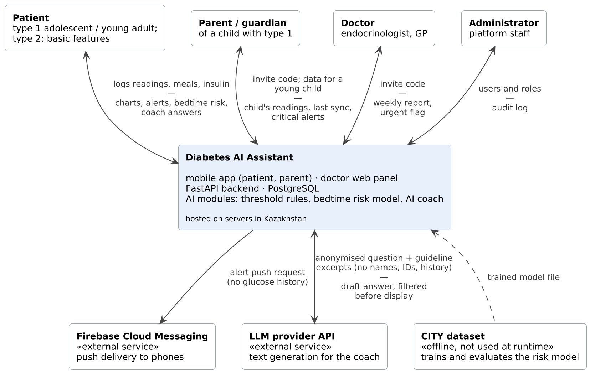
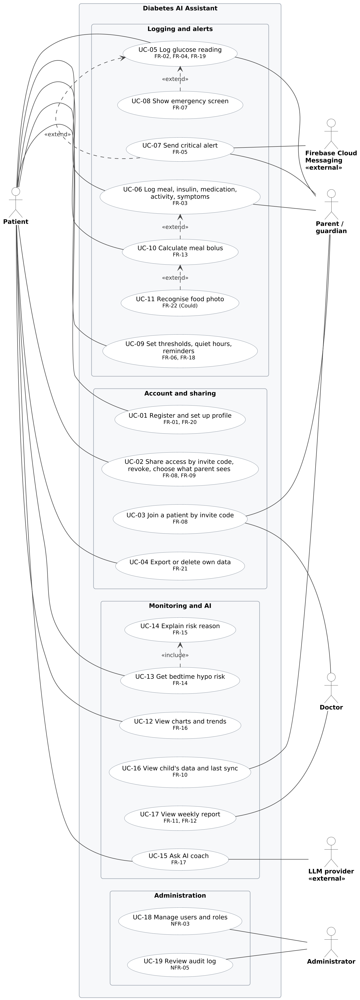
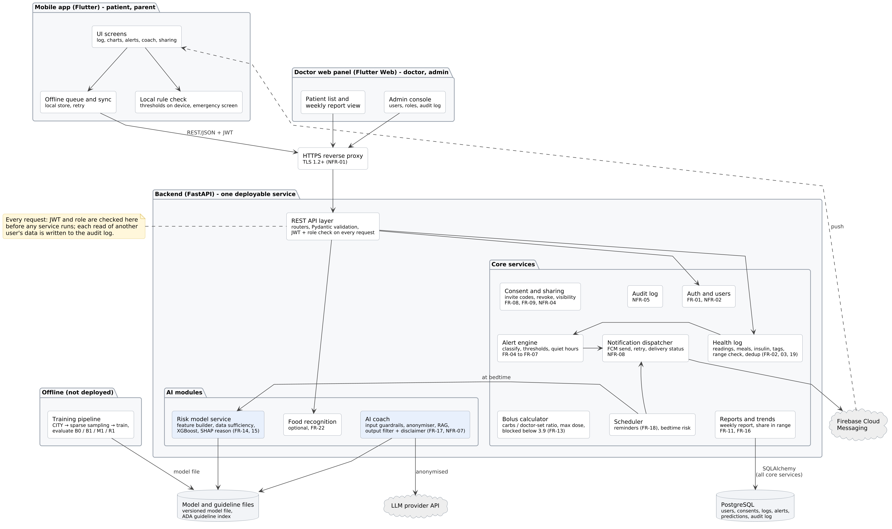
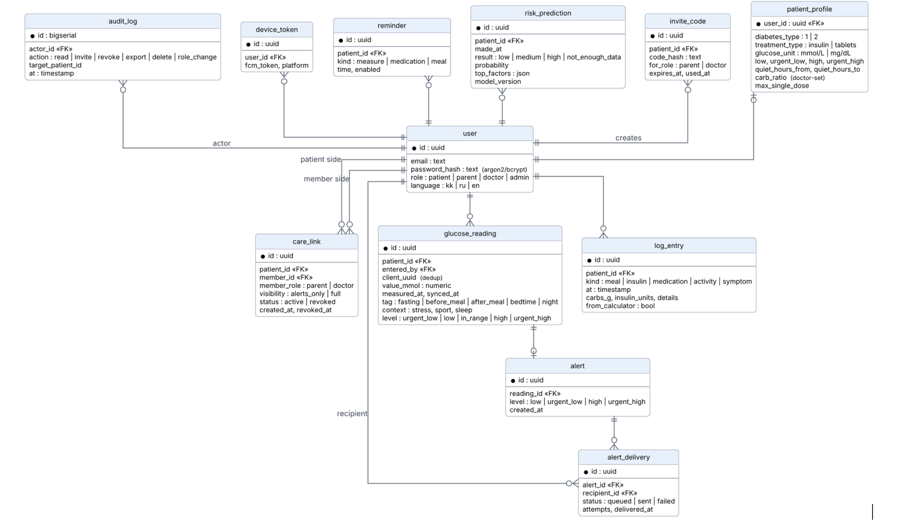
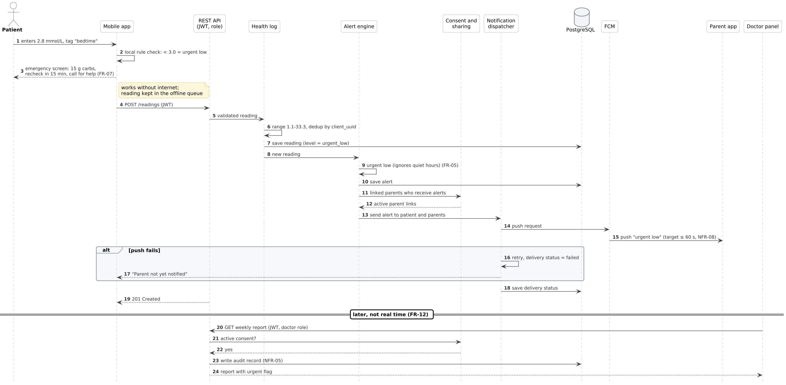

# Architecture and Diagrams

This section shows how the requirements are turned into a system design. It contains five diagrams: the system context (Figure 1), the use cases (Figure 2), the components (Figure 3, draft), the data model (Figure 4, draft) and the key scenario of a critical low reading (Figure 5). The same identifiers are used everywhere: FR and NFR numbers from the requirements, UC numbers for use cases and E2E numbers from the verification plan. Section 7 checks that every requirement has a use case, a component, data and a test. Editable PlantUML sources and PNG/SVG exports are stored in the diagrams/ folder of the repository.

## 1. Architectural overview

Diabetes AI Assistant is a client–server system. Two clients built from one Flutter code base – the mobile app for patients and parents and the web panel for doctors and administrators – work with one FastAPI backend through a REST API over HTTPS. The backend is a modular monolith: one deployable service divided into core services and AI modules with clear boundaries. All health data is stored in one PostgreSQL database on servers in Kazakhstan. Two external services are used: Firebase Cloud Messaging for push alerts and an LLM provider API for the AI coach. The risk model is trained offline on the CITY dataset and deployed as a versioned model file.

*Table 1 – Key architectural decisions*

| ID | Decision | Reason | Requirements |
| --- | --- | --- | --- |
| AD-1 | One backend service with separate modules (modular monolith), run with Docker Compose | A team of two; one deployment and one database are easier to test and maintain; modules can be split later | NFR-11 |
| AD-2 | Access is checked in one place: the API layer checks the JWT, the role and the active consent before any module runs | Health data is sensitive; one check point is easier to test | NFR-03, NFR-04, NFR-05 |
| AD-3 | Critical values are checked twice: on the phone (local rule check) and on the server (alert engine) | The emergency screen must work without internet; parents are notified by the server | FR-05, FR-07, NFR-08 |
| AD-4 | Rules classify each reading; the ML model only predicts bedtime risk | Current values follow clinical thresholds; ML is used where rules are weak (future night lows) | FR-04, FR-14 |
| AD-5 | The AI coach is isolated: input guardrails, anonymiser, RAG, output filter | No names, IDs or glucose history leave the backend; no doses or diagnoses | FR-17, NFR-07 |
| AD-6 | The bolus calculator is a deterministic module outside the AI modules | The dose comes only from the doctor-set ratio and is unit-tested | FR-13 |
| AD-7 | Model training is offline and not deployed | Reproducible evaluation (B0, B1, M1, R1); CITY data is not stored on the production server | FR-14, NFR-06 |

## 2. System context diagram

*Figure 1 – System context diagram*

Figure 1 shows the system as one box and everything it exchanges with its environment.

- **Patient and parent:** log readings, meals and insulin and receive charts, alerts, the bedtime risk and coach answers. A parent can enter data for a young child.
- **Doctor:** sees a weekly report and an urgent flag, but only after the patient shares an invite code; the panel states that the doctor does not monitor the patient in real time (FR-12).
- **Administrator:** manages users and roles and reviews the audit log, without access to clinical data by default.
- **External services:** Firebase Cloud Messaging receives only the alert type and the recipient token; the LLM provider receives only the anonymised question and guideline excerpts. The CITY dataset is used offline and is not connected at runtime.

## 3. Use case diagram

*Figure 2 – Use case diagram*

Figure 2 shows 19 use cases in four groups. Each use case is labelled with the functional requirements it implements, so every Must requirement appears in at least one use case. The patient is the main actor. The parent shares two logging use cases with the patient (UC-05, UC-06) because in 5 of 20 surveyed families the child does not log data alone. “Send critical alert” (UC-07) and “Show emergency screen” (UC-08) extend “Log glucose reading” only when the value is critical; “Calculate meal bolus” (UC-10) optionally extends meal logging and can itself be extended by food photo recognition (UC-11, Could). Every bedtime risk result includes its reason (UC-14), because a warning without a reason is not allowed (FR-15).

## 4. Component diagram (draft)

*Figure 3 – Component diagram (draft)*

*Table 2 – Components and their responsibilities*

| Component | Responsibility | Requirements | Main data |
| --- | --- | --- | --- |
| Mobile app: UI, local rule check, offline queue | Screens for logging, charts, alerts, coach and sharing; checks thresholds on the phone and shows the emergency screen; keeps readings while offline and syncs later | FR-02, FR-07, FR-10, FR-20, NFR-10 | local store |
| Doctor web panel | Patient list, weekly report with urgent flag, admin console | FR-11, FR-12 | — |
| HTTPS reverse proxy | Ends TLS; plain HTTP is refused or redirected | NFR-01 | — |
| REST API layer | Routers, Pydantic validation, JWT + role + consent check, audit record for every read of another user's data | NFR-03, NFR-05 | audit_log |
| Auth and users | Registration, login, profile, hashed passwords, export and deletion of own data | FR-01, FR-06, FR-21, NFR-02 | user, patient_profile |
| Consent and sharing | Invite codes, links, revoke, parent visibility | FR-08, FR-09, NFR-04 | invite_code, care_link |
| Health log | Readings, meals, insulin, medication, activity, symptoms, context tags; range check and deduplication | FR-02, FR-03, FR-19 | glucose_reading, log_entry |
| Alert engine | Classifies each reading, applies personal thresholds and quiet hours, creates alerts | FR-04, FR-05, FR-06 | alert |
| Notification dispatcher | Sends pushes through FCM, retries, stores delivery status | FR-05, FR-18, NFR-08 | alert_delivery, device_token |
| Scheduler | Reminders and the bedtime risk run | FR-14, FR-18 | reminder |
| Reports and trends | Weekly report, share of readings in range, averages by time of day, repeated lows/highs | FR-11, FR-16 | glucose_reading, log_entry, alert |
| Bolus calculator | Carbohydrates / doctor-set ratio; blocked below 3.9 mmol/L; maximum dose; user confirms | FR-13 | patient_profile, log_entry |
| Risk model service | Builds features from sparse readings, checks data sufficiency, runs the gradient-boosting model, turns SHAP values into a plain-language reason | FR-14, FR-15 | risk_prediction, model file |
| AI coach | Input guardrails, anonymiser, retrieval from ADA guideline index, LLM call, output filter and disclaimer | FR-17, NFR-07 | guideline index |
| Food recognition (optional) | Estimates carbohydrates from a photo; the user confirms the value | FR-22 | log_entry |
| Training pipeline (offline) | CITY → sparse meter sampling → training and evaluation of B0, B1, M1, R1 → model file | FR-14 | model file |

Bedtime risk flow: when the patient logs a bedtime reading (or at the bedtime set in the profile), the scheduler calls the risk model service. The service checks that there are enough recent readings (otherwise it returns “Not enough data”), builds the features, runs the model, keeps the top SHAP factors and saves the result with the model version. A high risk is shown to the patient with its reason and, if the parent link allows alerts, sent to the parent.

## 5. Data model (draft)

*Figure 4 – Data model (draft)*

- **Consent:** A parent or doctor is linked to a patient through care_link. Every request for patient data checks that an active link exists; revoking sets status = revoked, so access stops on the next request (NFR-04, E2E-4).
- **Readings:** Values are stored in mmol/L and converted to mg/dL only for display. client_uuid prevents double counting when the offline queue resends a reading.
- **Explainability:** risk_prediction stores the result, top factors and model version, so any warning can be explained and traced to the model that produced it (FR-15).
- **Audit:** audit_log is append-only: records are added and never changed (NFR-05).

## 6. Key scenario: critical low reading at bedtime

*Figure 5 – Sequence diagram for a critical low reading (E2E-3)*

Figure 5 follows scenario E2E-3 and shows how the components work together. The phone shows the emergency screen first, even without internet (steps 1–3). The server then validates and saves the reading, the alert engine ignores quiet hours for an urgent low, finds the parents with an active link and the dispatcher sends the push (steps 4–15). If the push fails, the patient sees “Parent not yet notified” (steps 16–17). The doctor sees the urgent flag later in the weekly report, and this access is written to the audit log (steps 20–24).

## 7. Alignment of requirements, components, data and scenarios

Table 3 traces each functional requirement through the diagrams to its test. Table 4 shows which part of the architecture implements each Must non-functional requirement.

*Table 3 – Traceability of functional requirements*

| FR | Use case | Component | Data | Verified by |
| --- | --- | --- | --- | --- |
| FR-01 | UC-01 | Auth and users | user, patient_profile | E2E-1 |
| FR-02 | UC-05 | Health log | glucose_reading | E2E-2 |
| FR-03 | UC-06 | Health log | log_entry | Unit, API tests |
| FR-04 | UC-05 | Alert engine, local rule check | glucose_reading.level | Unit tests, E2E-2 |
| FR-05 | UC-07 | Alert engine, consent, dispatcher | alert, alert_delivery, care_link | E2E-3, delivery tests |
| FR-06 | UC-09 | Auth and users, alert engine | patient_profile | Unit tests |
| FR-07 | UC-08 | Mobile: local rule check | on device | E2E-3 |
| FR-08 | UC-02, UC-03 | Consent and sharing | invite_code, care_link | E2E-1, E2E-4 |
| FR-09 | UC-02 | Consent and sharing | care_link.visibility | Access tests |
| FR-10 | UC-16, UC-05 | Mobile UI, health log | glucose_reading | E2E-2, E2E-3 |
| FR-11 | UC-17 | Reports and trends, web panel | glucose_reading, log_entry, alert | API tests, E2E |
| FR-12 | UC-17 | Doctor web panel | — | Manual check |
| FR-13 | UC-10 | Bolus calculator | patient_profile, log_entry | Unit tests |
| FR-14 | UC-13 | Scheduler, risk model service | risk_prediction | Eval. 3.1, E2E-6 |
| FR-15 | UC-14 | Risk model service | risk_prediction.top_factors | Eval. 3.1 |
| FR-16 | UC-12 | Reports and trends | glucose_reading | Eval. 3.2 |
| FR-17 | UC-15 | AI coach | guideline index | Eval. 3.3, E2E-5 |
| FR-18 | UC-09 | Scheduler, dispatcher | reminder | Unit tests |
| FR-19 | UC-05 | Health log | glucose_reading.context | Unit tests |
| FR-20 | UC-01 | Mobile UI | user.language | Usability test |
| FR-21 | UC-04 | Auth and users, audit log | all patient tables, audit_log | API tests |
| FR-22 | UC-11 | Food recognition | log_entry | Eval. 3.4 |

*Table 4 – Must non-functional requirements in the architecture*

| NFR | Where it is implemented | Verified by |
| --- | --- | --- |
| NFR-01 HTTPS only | HTTPS reverse proxy (TLS 1.2+) | Integration test |
| NFR-02 Password hashing | Auth and users; user.password_hash | Unit test, DB inspection |
| NFR-03 Role-based access | REST API layer: JWT + role check for every request | Access control tests |
| NFR-04 Grant and revoke consent | Consent and sharing; care_link.status checked on every request | E2E-1, E2E-4 |
| NFR-05 Audit log | REST API layer writes audit_log; append-only table | API tests, E2E-4 |
| NFR-06 No secrets or real data | Training pipeline and datasets kept outside the repository; secrets in environment variables | Security checks in CI |
| NFR-07 No doses or diagnoses from AI | AI coach guardrails and output filter; bolus calculator separate from AI | AI safety set (3.3) |
| NFR-08 Fast critical alerts | Local rule check, alert engine, dispatcher with retries | Alert delivery tests |

## 8. Open points for pre-defense 2

- **To decide:** where to keep the guideline index for RAG (pgvector in PostgreSQL or a file index); which library runs scheduled jobs.
- **To add:** a deployment diagram (Docker Compose services) after the first deployment; the component diagram is updated as modules are implemented.
