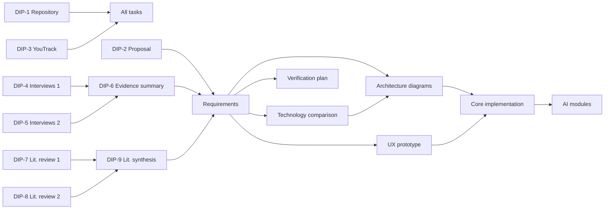

# Project Management

**Project:** Diabetes AI Assistant — “Development of a Mobile Application for Diabetes Monitoring and Management Using Artificial Intelligence Methods”  
**Team:** Aruzhan Toktarbekova, Ainur Boranova (group SE-2411)  
**Supervisor:** Altynbek Seitenov  
**YouTrack:** [diabetes-ai-diploma.youtrack.cloud](https://diabetes-ai-diploma.youtrack.cloud)  
**Repository:** [Aruzhan233/diabetes-ai-assistant](https://github.com/Aruzhan233/diabetes-ai-assistant)

## 1. Tools and Workflow

- **YouTrack** is used to plan and track all work. Every meaningful work item is a task (`DIP-N`) with an assignee, expected outcome, acceptance criteria and deadline.
- **Kanban board columns:** Queue → Development → Review → Test → On test environment → Done.
- **Tags** link tasks to milestones: `pre-defense-1`, `pre-defense-2`, `final`.
- **GitHub workflow:** one branch per task (`DIP-N-short-name`), commit messages start with the task ID (`DIP-N: ...`), changes reach `main` only through a pull request reviewed by the other team member.
- **Traceability:** each YouTrack task contains a link to its pull request; a task is moved to Done only when its acceptance criteria are met and the pull request is merged.
- **Supervisor review:** key deliverables are sent to the supervisor before each pre-defense; comments and the decisions taken are recorded in the related YouTrack task.
- **Submissions:** the exact version for each stage is marked with a Git tag: `pre-defense-1`, `pre-defense-2`, `final-pre-defense`.

## 2. Team Roles

*Table 1 – Allocation of responsibilities*

| Area | Aruzhan Toktarbekova | Ainur Boranova |
|---|---|---|
| Project setup | Repository, README and structure (DIP-1) | YouTrack, milestones, risks and dependencies (DIP-3) |
| Proposal | Project proposal and scope (DIP-2) | Review |
| Evidence of relevance | User interviews – set 1 (DIP-4) | User interviews – set 2 (DIP-5), evidence summary (DIP-6) |
| Literature review | Part 1 (DIP-7) | Part 2 (DIP-8), synthesis (DIP-9) |
| Code review | Reviews Ainur’s pull requests | Reviews Aruzhan’s pull requests |

The full list of tasks and assignees is maintained in YouTrack.

## 3. Milestones

*Table 2 – Project milestones*

| Milestone | Tag | Date | Deliverables |
|---|---|---|---|
| Pre-defense 1 | `pre-defense-1` | 24 Oct 2026 | Proposal and scope, evidence of relevance (interviews), literature review, existing system comparison, technology comparison, requirements with acceptance criteria, architecture diagrams, UX prototype, verification and evaluation plan, GitHub and YouTrack set up |
| Pre-defense 2 | `pre-defense-2` | According to the department schedule | Core implementation: authentication and roles, consent management (invite codes), logging of glucose, food, insulin and activity, charts, critical-value alerts, audit log; automated tests in CI |
| Final pre-defense | `final` | According to the department schedule | AI modules (trend analysis, risk scoring, AI coach), evaluation against baselines, full testing, final documentation |

## 4. Risks and Mitigation

Likelihood and impact are rated as High (H), Medium (M) or Low (L).

*Table 3 – Main project risks*

| ID | Risk | Likelihood | Impact | Mitigation |
|---|---|---|---|---|
| R1 | **Medical liability:** the AI gives incorrect or unsafe advice (e.g., an insulin dose) | M | H | Recommendation-only mode; no dose calculation or diagnosis; disclaimer on every AI answer; safety test set with a 100% pass requirement; medical decisions are always referred to a doctor |
| R2 | **Data privacy:** leak or unauthorised access to health data | M | H | Role-based access control; access only with patient consent (invite code, revocation); audit log; HTTPS and hashed passwords; only anonymised summaries sent to the LLM; no real data or secrets in the repository |
| R3 | **AI accuracy:** risk scoring or food recognition is not accurate enough | H | M | Rule-based baseline for comparison; confidence levels shown to the user; manual correction; limitations reported honestly; food recognition has “Could” priority |
| R4 | **Low user engagement:** users stop logging data regularly | M | M | Logging a reading in 3 taps or fewer; reminders; weekly reports that show value; usability testing with 5 participants |
| R5 | **Regulation:** the app could be treated as a medical device | L | H | Positioned as an informational support tool; clinical decisions out of scope; consultation with specialists |
| R6 | **Dataset limitations:** the CITY dataset differs from real app usage (CGM every 5 minutes vs. manual entry; ages 14–24 only) | M | M | Use the public CITY dataset with a split by participant; simulate sparse manual entries by sampling CGM readings; report limitations honestly; follow the dataset’s terms of use |
| R7 | **Interviews:** difficulty finding patients, parents and doctors to interview | M | M | Contact diabetes schools, patient communities and medical universities early; anonymous interviews; online format |
| R8 | **Time constraints:** a team of two cannot finish all features | M | H | Must/Should/Could prioritisation; Must features first; weekly progress review on the Kanban board |

## 5. Dependencies

### 5.1 Dependencies between tasks

*Table 4 – Task dependencies*

| Task | Depends on | Reason |
|---|---|---|
| All tasks | DIP-1 (repository), DIP-3 (YouTrack) | Work is tracked in YouTrack and stored in the repository |
| DIP-6 Evidence of relevance summary | DIP-4, DIP-5 (interviews) | The summary is based on interview results |
| DIP-9 Literature review synthesis | DIP-7, DIP-8 (literature review parts) | The synthesis combines both parts |
| Requirements specification | DIP-2 (proposal and scope), DIP-6 (evidence), DIP-9 (literature) | Requirements follow from the scope, user needs and known approaches |
| Technology comparison | Requirements specification | Technology choices are justified by the requirements |
| Architecture diagrams | Requirements, technology comparison | Components and data must match the requirements and the chosen stack |
| UX prototype | Requirements, use case diagram | Mockups cover the key user scenarios |
| Verification and evaluation plan | Requirements (acceptance criteria) | Every Must requirement needs a test |
| Core implementation (pre-defense 2) | Architecture, UX prototype | Code follows the approved design |
| AI modules (final) | Core implementation, CITY dataset preparation | AI needs logged data structures and prepared test data |

### 5.2 External dependencies

- **Interview participants:** patients with diabetes, parents and medical specialists must agree to take part.
- **Supervisor:** review of key deliverables before each pre-defense.
- **Datasets:** the CITY dataset (CGM Intervention in Teens and Young Adults with T1D study) is used for risk scoring and trend analysis; Food-101 and Nutrition5k are publicly available for the optional food recognition.
- **External services:** an LLM API key for the AI coach and a Firebase project for push notifications (keys are kept out of the repository).
